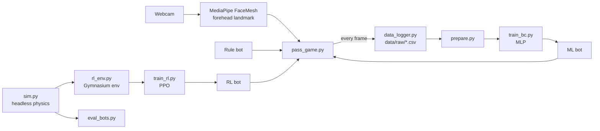
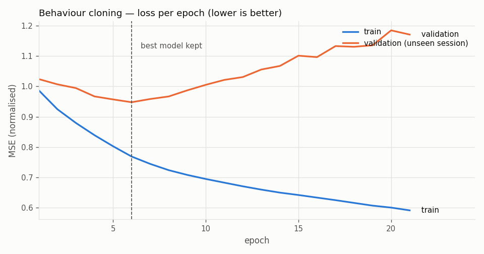

# Head Ball AI

A webcam heading game where you pass a ball back and forth with an AI partner, using only your head. MediaPipe tracks your forehead, and three bots take the other side of the court:

- a **rule-based** bot that predicts the ball's flight with physics,
- an **imitation-learning** bot trained on my own gameplay,
- a **reinforcement-learning** bot (PPO) that taught itself by playing half a million frames in a headless simulator.

The point of the project is the comparison. Every bot has the same body (speed limit, header power, collision rule), so the only thing that differs is the brain.

<!-- TODO: record 15-20 s of gameplay (Win + Alt + R), convert to GIF, save as docs/demo.gif -->


---

## Results

### In the simulator (200 rallies per bot, same partner, same balls, seed 0)

| Bot | Avg rally | Median | Bot reach | Pass quality |
|---|---|---|---|---|
| STILL (never moves, the floor) | 0.80 | 0 | 41.7% | 86.4% |
| RULE (hand-written physics) | 15.32 | 15 | 99.7% | 92.6% |
| ML (imitation, v2) | **TODO** | **TODO** | **TODO** | **TODO** |
| RL (PPO) | **TODO** | **TODO** | **TODO** | **TODO** |

- **Bot reach**: balls the partner sent over that the bot got to.
- **Pass quality**: bot passes the partner could head back.
- Rallies stop at 30 passes. RULE hits that cap in 23% of rallies.

### Against a real person (me, webcam)

| Bot | Avg rally | Best | Rallies played |
|---|---|---|---|
| RULE | **TODO** | **TODO** | **TODO** |
| ML | **TODO** | **TODO** | **TODO** |
| RL | **TODO** | **TODO** | **TODO** |

<!-- TODO: one sentence on the sim vs real difference you saw, especially for RL -->

---

## How it works



### 1. Rule-based bot (the baseline)
Each frame it copies the ball, simulates its future with the game's own physics, and walks to where the ball will come down. It also solves the projectile equation to choose how off-centre to hit the ball so the pass lands on the player's head.

### 2. Imitation-learning bot (behaviour cloning)
- **Data:** every frame of my play is logged: ball state, my head, the partner's position, hits and drops.
- **Cleaning:** removes pauses, MediaPipe jitter, and the last second before each of my drops, so the bot copies successes and not mistakes.
- **Model:** small MLP (64-64) in PyTorch. Normalisation is stored inside the model, so training and the game always use the same numbers.
- **Mirroring:** the model only ever learns "I am the left player". The bot on the right mirrors the world (`x -> 1 - x`), asks the model, and mirrors the answer back.

### 3. Reinforcement-learning bot (PPO)
- **Environment:** the game as a Gymnasium env, with no camera or window. A scripted partner (`SimHuman`) plays the left side with a random aim error.
- **Observation:** ball position and velocity, own head, partner head (8 numbers).
- **Action:** head velocity, capped at the same speed limit as the other bots.
- **Reward:** +1 for receiving a pass, +1 when the partner returns my pass, -1 for a drop on my side, -0.5 for a bad pass, plus a small hint for standing under an incoming ball.

<!-- TODO: embed training curves once generated -->
| Imitation learning | Reinforcement learning |
|---|---|
|  |  |

---

## What went wrong, and what I learned

**The first ML bot was worse than a bot that stands still.**
With only 1.6 minutes of my own gameplay (3,080 frames, one session), the first imitation model got R² = 0.23 on sideways movement, and validation loss started rising after epoch 5 (overfitting). In the simulator it reached **0%** of balls. The STILL baseline reached 28% just by being in the way.

**Diagnosis:** the model predicted a *speed*. A tiny bias in that speed is added up every frame, so the bot slid into the edge of its court and stayed there. This is the classic compounding-error problem of behaviour cloning.

**Fix (v2):**
1. Predict a **target position** ("where will my head be in 0.3 s?") instead of a speed. A wrong target means standing a few pixels off, and the error does not add up.
2. Remove the bot's **own position** from the inputs. Otherwise the model learns the shortcut "target ≈ where I am now" and the drift comes back.

**Other decisions worth explaining:**
- **Session-based validation split.** At 30 fps, neighbouring frames are almost identical. A random split leaks them between train and validation, and the score looks great while meaning nothing.
- **A STILL baseline.** Without it, "ML bot is a bit weak" would have hidden that it had learned nothing useful.
- **Reward hacking guard.** The positioning hint is only paid for balls coming *from the partner*. Otherwise the RL bot could juggle the ball to itself and farm the hint instead of passing.
- **Sim-to-real gap.** The RL bot learned against `SimHuman`, not a real person. Its simulator score is its home ground, so it is also tested against a real player.
- **One shared physics function** (`try_header`) for the human, every bot, the simulator and the RL environment, so a result in one is valid in the others.

---

## Project structure

| File | What it does |
|---|---|
| `header_game.py` | Header Hoops mode + shared pieces: `Ball`, `HeadTracker`, `try_header` |
| `pass_game.py` | Co-op pass mode with bots. `B` switches bot, `L` toggles recording |
| `bots.py` | `RuleBot`, `MLBot`, `RLBot` (same body, different brains) |
| `data_logger.py` | Records gameplay to `data/raw/` |
| `features.py` | One function that turns game state into model input (used in training and in the game) |
| `prepare.py` | Raw logs -> clean state/target pairs + data chart |
| `bc_model.py`, `train_bc.py` | Imitation-learning model and training |
| `sim.py` | Headless game + `SimHuman` partner |
| `eval_bots.py` | Repeatable bot comparison |
| `rl_env.py`, `train_rl.py` | Gymnasium environment + PPO training |

---

## Run it

Python 3.10. `mediapipe` must stay at 0.10.21, because newer versions removed the `mp.solutions` API this project uses.

```bash
python -m venv .venv
.venv\Scripts\activate          # Windows
pip install -r requirements.txt
```

| Goal | Command |
|---|---|
| Play (pass mode) | `python pass_game.py` |
| Play (Header Hoops) | `python header_game.py` |
| Train the imitation bot | play a few sessions, then `python prepare.py` and `python train_bc.py` |
| Train the RL bot | `python train_rl.py` (about 10-20 min on CPU) |
| Compare all bots | `python eval_bots.py` |

Controls: `SPACE` start, `B` switch bot, `L` pause recording, `Q` quit.

---

## Next steps
- **Web version:** port the game to JavaScript with MediaPipe in the browser and the models exported to ONNX, so it runs from a link.
- **Adaptive difficulty:** the bot adjusts its passes to how well the player is doing.
- **More gameplay data** from different players, and DAgger-style training for the imitation bot.

## Tech
Python, PyTorch, Stable-Baselines3 (PPO), Gymnasium, MediaPipe, OpenCV, Pygame, pandas, matplotlib

## Team
Built by :
-[Shreeya Shrestha](https://github.com/shreeya-12shrestha)
-[Suyasa Sigdel](https://github.com/SuyasaSigdel01).